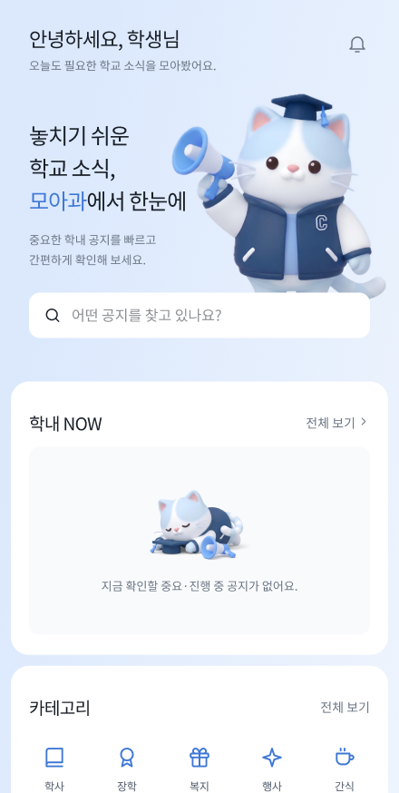
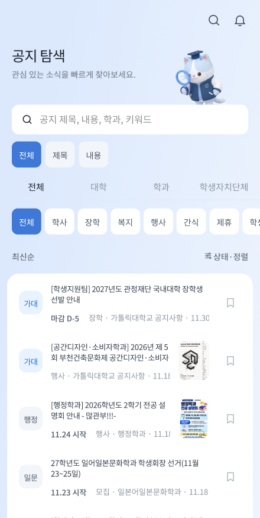
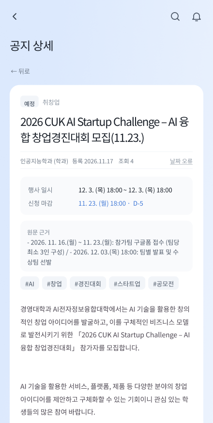
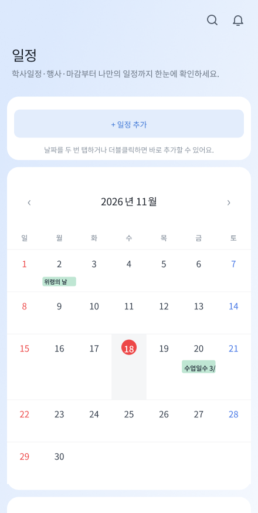
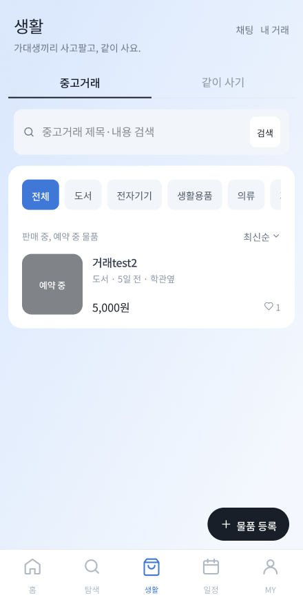
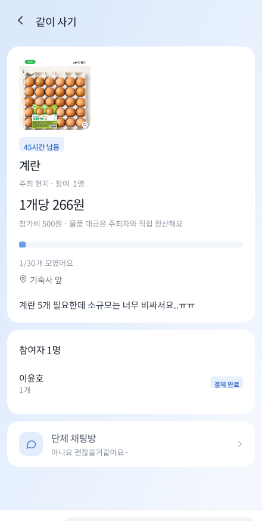
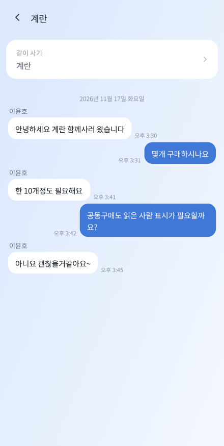
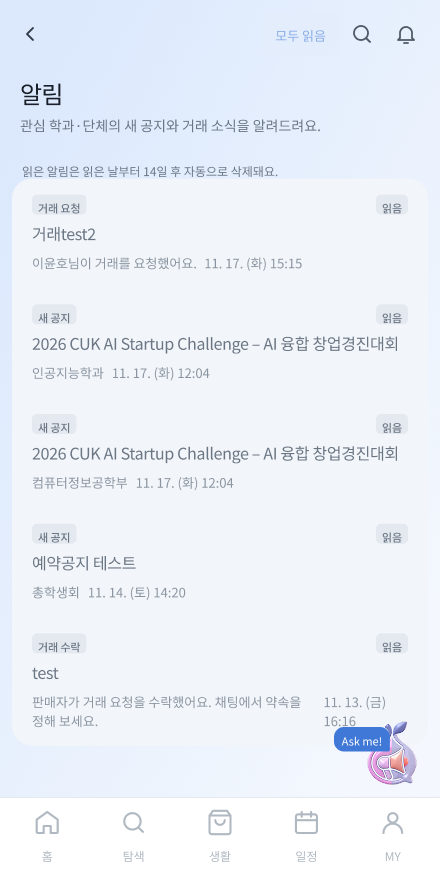
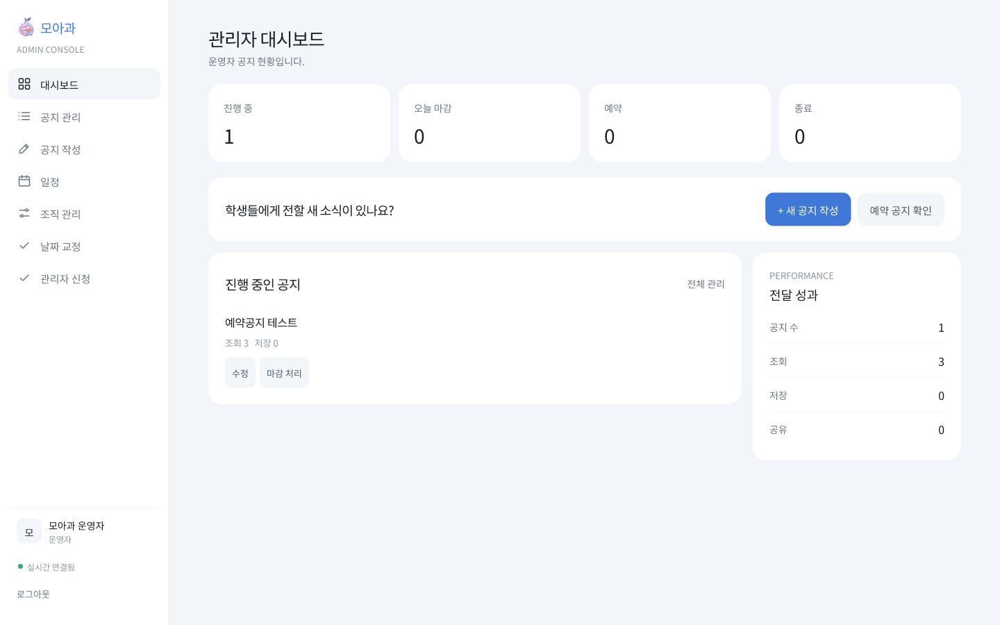

# 모아과 프론트엔드

가톨릭대학교 학내 공지, 일정, 생활 거래를 한곳에서 보는 학생용 웹과 단체 관리자용 콘솔. Next.js App Router 하나에 학생 화면과 관리자 화면을 함께 둠.

🔗 서비스: https://moagwa.zruor.cc

## 화면

| 홈 | 공지 탐색 | 공지 상세 | 일정 |
|:-:|:-:|:-:|:-:|
|  |  |  |  |

| 생활 거래 | 같이 사기 | 채팅 | 알림 |
|:-:|:-:|:-:|:-:|
|  |  |  |  |

**관리자 콘솔**



## 주요 화면

| 구분 | 경로 | 내용 |
| --- | --- | --- |
| 학생 | `/home` | 학내 NOW(중요, 진행 중 공지), 카테고리, 나를 위한 공지, 최신 공지 |
| | `/explore` | 발행 주체, 카테고리 필터, 검색 범위(전체, 제목, 내용), 정렬 |
| | `/notices/[source]/[id]` | 공지 상세, 사진 확대 뷰어, 첨부파일, 북마크, 공유, 날짜 교정 요청 |
| | `/schedule` | 학사일정, 저장한 공지, 개인 일정 달력. 일정별 색상, 리마인더 |
| | `/life` | 중고거래, 같이 사기(토스 결제), 채팅, 내 거래, 재학생 인증 |
| | `/notifications`, `/my` | 알림함, 관심 설정, 알림 수신 설정, 회원 탈퇴 |
| | 모든 학생 화면 | 학교 안내 챗봇 창(`ChatbotWidget`) |
| 관리자 | `/admin/dashboard` | 진행 중 공지, 오늘 마감, 예약, 전달 성과 |
| | `/admin/notices` | 공지 작성(블록 편집기, 미리보기, 템플릿), 예약 게시, 마감, 복제, 알림 다시 보내기 |
| | `/admin/schedule`, `/admin/organization` | 관리 일정, 단체 정보 |
| 운영자 | `/admin/applications`, `/admin/corrections` | 단체 관리자 신청 검토, 날짜 교정 검토 |
| 공개 | `/login`, `/admin-apply`, `/terms`, `/privacy` | 소셜 로그인, 단체 관리자 신청, 약관 |

## 기술 스택

| 분류 | 사용 기술 |
| --- | --- |
| 프레임워크 | Next.js 16 (App Router), React 19, TypeScript |
| 스타일 | Tailwind CSS 4, `src/app/globals.css`의 공통 디자인 토큰과 클래스 |
| 서버 상태 | TanStack Query |
| 실시간 | SSE(공지 갱신, 챗봇 답변), STOMP over WebSocket(채팅) |
| 로그인, 푸시 | Firebase Authentication(Google), Kakao OAuth, Firebase Cloud Messaging |
| 결제 | 토스페이먼츠 결제위젯 |
| 테스트 | Node 테스트 러너(`tests/`), Playwright(`e2e/`) |

## 설계 기준

- **휴대폰 폭 우선**: 학생 화면은 데스크톱에서도 최대 600px 폭으로 보여 줌. 관리자 콘솔은 데스크톱 레이아웃
- **반응형 구간**: 600px 이하 하단 탭, 601~1023px 사이드 메뉴, 1024px 이상 데스크톱. 기준은 [docs/notes.md](docs/notes.md#반응형-화면-검사)
- **오류 표시**: 입력 오류와 요청 실패는 해당 입력칸이나 버튼 옆에 표시(`InlineError`). 토스트는 성공 안내에만 씀
- **로그인 세션**: 토큰은 HttpOnly 쿠키에만 있고, 만료 시 FE가 리프레시를 한 번 시도한 뒤 원래 요청을 다시 보냄
- **웹앱**: 홈 화면 추가(PWA, `manifest.ts`), 서비스 워커로 백그라운드 푸시 수신

## 로컬 실행

```bash
npm install
npm run dev          # http://localhost:3000
```

BE는 별도로 `localhost:8080`에서 실행([BE README](https://github.com/Moa-Gwa/BE#로컬-실행) 참고). 개발 서버가 켜져 있는 동안 `npm run build`를 실행하면 `.next`가 깨지므로 서버를 먼저 끔.

### Google 로그인까지 확인할 때(HTTPS)

Google 로그인은 리디렉션 방식이라 `authDomain`을 앱 주소로 두고 HTTPS로 실행해야 함. Firebase 인증 화면(`/__/auth/...`)은 `next.config.ts`에서 Firebase 인증 서버로 프록시함.

1. `.env.local`에 `NEXT_PUBLIC_FIREBASE_AUTH_DOMAIN=localhost:3000`, `NEXT_PUBLIC_API_BASE_URL=`(빈 값, 같은 출처의 `/api` 프록시 사용) 설정
2. `npm run dev:https` 실행 후 https://localhost:3000 접속. 처음 실행하면 로컬 인증서를 `certificates/`에 만들고 키체인 신뢰 등록을 요청함
3. 콘솔 설정(최초 1회)
   - Firebase 콘솔 > Authentication > 승인된 도메인에 `localhost` 포함
   - Google Cloud 콘솔 OAuth 클라이언트의 리디렉션 URI에 `https://localhost:3000/__/auth/handler` 등록

`authDomain`을 `*.firebaseapp.com`으로 두면 Safari처럼 다른 도메인 저장소를 막는 브라우저에서 로그인 결과를 받지 못함.

## 환경 변수

`.env.local`에 작성(git 제외). 값은 팀 내부에서 공유함.

```bash
NEXT_PUBLIC_API_BASE_URL=http://localhost:8080   # HTTPS 실행 시 빈 값

NEXT_PUBLIC_FIREBASE_API_KEY=
NEXT_PUBLIC_FIREBASE_AUTH_DOMAIN=                # 로컬 HTTPS는 localhost:3000, 운영은 moagwa.zruor.cc
NEXT_PUBLIC_FIREBASE_PROJECT_ID=
NEXT_PUBLIC_FIREBASE_MESSAGING_SENDER_ID=
NEXT_PUBLIC_FIREBASE_APP_ID=
NEXT_PUBLIC_FIREBASE_VAPID_KEY=

NEXT_PUBLIC_KAKAO_CLIENT_ID=
NEXT_PUBLIC_TOSS_CLIENT_KEY=                     # 토스페이먼츠 결제위젯 클라이언트 키
```

`NEXT_PUBLIC_*`는 빌드할 때 번들에 들어감. 운영 값은 GitHub 저장소 Variables에서 관리하며, 값을 바꾸면 `main`에 새 커밋이 들어가 이미지를 다시 빌드해야 운영에 반영됨.

## 테스트

```bash
npm run lint
npm test                 # 단위 테스트(Node 22.18 이상)
npm run test:e2e         # 브라우저 테스트. E2E 전용 BE와 DB가 필요함
```

브라우저 테스트는 가짜 응답 대신 실제 BE(local 프로필)와 PostgreSQL에 붙어 실행함. 준비 방법은 [e2e/README.md](e2e/README.md) 참고.

## 배포

| 단계 | 내용 |
| --- | --- |
| PR | Lint, 단위 테스트, 빌드, 브라우저와 반응형 검사(develop BE 이미지와 PostgreSQL을 띄워 실행) |
| `main` 머지 | `linux/arm64` 이미지를 `ghcr.io/moa-gwa/fe:sha-<커밋>`으로 올리고 infra 저장소의 이미지 태그를 바꿈 |
| 운영 반영 | Argo CD가 infra 저장소 변경을 감지해 k3s 클러스터에 배포 |

브랜치는 `feature/*` → `develop`(squash) → `release/*` → `main`(merge commit). 자세한 규칙은 [CONTRIBUTING.md](CONTRIBUTING.md).

## 폴더 구조

```
src/app/(student)/   학생 화면(홈, 탐색, 공지 상세, 일정, 생활, MY, 알림)
src/app/admin/       관리자, 운영자 콘솔
src/components/      공통 UI(공지 카드, 블록 편집기, 이미지 뷰어, 달력, 챗봇 창 등)
src/hooks/           실시간 구독(SSE, STOMP), 푸시 토큰, 공통 조회
src/lib/             API 호출, 세션, 날짜 형식, 상수
public/              푸시 서비스 워커, 아이콘, 마스코트 이미지
tests/  e2e/         단위 테스트, Playwright 브라우저 테스트
docs/                화면 구현 메모, README 이미지
```

## 관련 문서

- [화면 구현 메모](docs/notes.md): 학교 공지 썸네일과 첨부파일, 이미지 뷰어와 사진 설명, 반응형 검사 기준
- [E2E 테스트](e2e/README.md)
- [기여 규칙](CONTRIBUTING.md)
